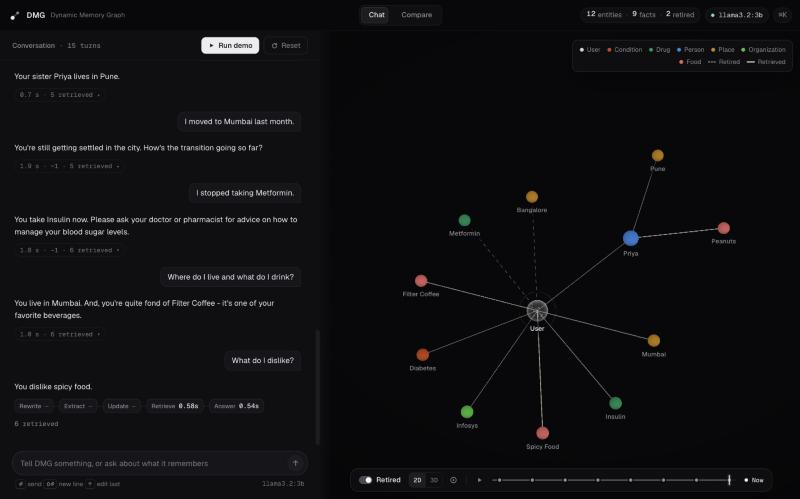

# Dynamic Memory Graph (DMG)

An external, persistent knowledge graph that gives small LLMs long-term conversational memory.

Small models like **Llama 3.2 3B** have a short context window (2048 tokens), so they forget what a user said a few turns ago. DMG fixes this without fine-tuning. It extracts facts from every user message as structured triples, stores them in a graph, and at query time injects only the relevant facts into the prompt instead of the full chat history.

> Course project, Artificial Intelligence, BML Munjal University.

---

## Architecture

```
┌─────────────────────────────────────────────────────────┐
│                    User Message                         │
└────────────────────────┬────────────────────────────────┘
                         │
                         ▼
┌─────────────────────────────────────────────────────────┐
│  1. Query Rewriter (Abhishek)                           │
│     • Detects pronouns and vague references             │
│     • Calls Llama 3.2 3B to resolve coreferences        │
│     • Graceful fallback: returns original if no refs     │
│     Input:  "What are its side effects?"                │
│     Output: "What are the side effects of Metformin?"   │
└────────────────────────┬────────────────────────────────┘
                         │
                         ▼
┌─────────────────────────────────────────────────────────┐
│  2. Entity & Triple Extractor (Arnav)                   │
│     • Few-shot prompted JSON extraction via Ollama      │
│     • Validates object_type ∈ {PERSON, CONDITION,       │
│       DRUG, PLACE, PREFERENCE}                          │
│     • Auto-fixes type variants (MEDICINE→DRUG)          │
│     • Retry on LLM failure, logging throughout          │
│     Output: [{"subject":"User", "predicate":"takes",    │
│               "object":"Metformin", "object_type":"DRUG"}]
└────────────────────────┬────────────────────────────────┘
                         │
                         ▼
┌─────────────────────────────────────────────────────────┐
│  3. Memory Manager (Aditya)                             │
│     • ADD: new fact → edge with created_at              │
│     • SKIP: exact or near-duplicate detected            │
│     • UPDATE: same (subject, predicate) → end old edge, │
│       add new one                                       │
│     • DELETE: negation predicate → end matching edge     │
│     • Entity aliases: Bengaluru→Bangalore, Mom→Mother   │
│     • Predicate synonyms: takes≈using≈on                │
│     • Edge deduplication across synonym groups           │
└────────────────────────┬────────────────────────────────┘
                         │
                         ▼
┌─────────────────────────────────────────────────────────┐
│  4. Graph Store (Arpit)                                 │
│     • NetworkX MultiDiGraph                             │
│     • Nodes = entities (typed: PERSON, DRUG, etc.)      │
│     • Edges = facts (predicate, created_at, ended_at)   │
│     • Persistence: JSON via node_link_data              │
│     • expand(): multi-hop walks (in + out edges)        │
│     • rerank(): recency-based sorting                   │
│     • graph_viz: matplotlib visualization               │
└────────────────────────┬────────────────────────────────┘
                         │
                         ▼
┌─────────────────────────────────────────────────────────┐
│  5. Hybrid Retriever (Kartika)                          │
│     ┌───────────┐  ┌────────────┐  ┌────────────────┐  │
│     │ BM25      │  │ Dense      │  │ Graph          │  │
│     │ (rank-bm25│  │ (FAISS +   │  │ (expand from   │  │
│     │  keyword) │  │  MiniLM)   │  │  query entities│  │
│     └─────┬─────┘  └─────┬──────┘  └──────┬─────────┘  │
│           │              │                 │            │
│           └──────────────┼─────────────────┘            │
│                          ▼                              │
│              Reciprocal Rank Fusion (k=60)              │
│                          │                              │
│                     top-5 facts                         │
└────────────────────────┬────────────────────────────────┘
                         │
                         ▼
┌─────────────────────────────────────────────────────────┐
│  6. Answer Generation                                   │
│     • System prompt with retrieved facts                │
│     • Llama 3.2 3B generates the answer                 │
│     • Facts are injected, not the full chat history     │
└─────────────────────────────────────────────────────────┘
```

---

## Web UI (3D)

A second front end next to the Streamlit app: a FastAPI server (`server.py`) and a React app in `web/`, with the memory graph in 3D. It uses the same pipeline; `streamlit run app.py` still works.

- **Chat:** each pipeline stage lights up as it runs, new facts draw into the graph, retired facts turn into dashed lines, and retrieved facts flow into the core by rank. Drag nodes, click one for its facts, scrub or replay the timeline, `⌘K` for commands. **Run demo** plays a script turn by turn; **Reset** clears the conversation, with or without memory.
- **Compare:** the same messages go to two baselines (last 4 turns, full history) and to DMG, with live scores, prompt tokens per turn and a flag when a baseline repeats a retired fact.

The built UI is committed in `web/dist`, so no Node is needed to run it (see Setup). Everything runs on localhost; fonts and libraries are bundled.

---

## How it works

**Entity types:** `PERSON`, `CONDITION`, `DRUG`, `PLACE`, `PREFERENCE`

**Example conversation:**

| Turn | User says | Pipeline action |
|------|-----------|-----------------|
| 1 | "I'm diabetic and take Metformin" | ADD: (User, has, Diabetes), (User, takes, Metformin) |
| 2 | "I live in Bangalore" | ADD: (User, lives_in, Bangalore) |
| 3 | "My sister Priya lives in Pune" | ADD: (User, has_sister, Priya), (Priya, lives_in, Pune) |
| ... | *(several unrelated turns)* | |
| 10 | "What medicine do I take?" | Retrieve: "User takes Metformin" → answers correctly |
| 11 | "I moved to Mumbai" | UPDATE: end "lives_in Bangalore", add "lives_in Mumbai" |
| 12 | "I stopped taking Metformin" | DELETE: end "takes Metformin" |

---

## Tech stack

| Purpose | Tool |
|---|---|
| Language | Python 3.10+ |
| LLM | Ollama, `llama3.2:3b` (runs locally) |
| Graph + persistence | NetworkX (JSON via `node_link_data`) |
| Keyword retrieval | rank-bm25 (`BM25Plus`) |
| Embeddings | sentence-transformers (`all-MiniLM-L6-v2`, 384-dim) |
| Vector search | FAISS (`IndexFlatIP`, cosine similarity) |
| Retrieval fusion | Reciprocal Rank Fusion (RRF, k=60) |
| UI | Streamlit; FastAPI + React/TypeScript + three.js (web UI) |
| Visualization | matplotlib + NetworkX drawing |

---

## Project structure

```
dynamic-memory-graph/
├── README.md
├── requirements.txt
├── config.py                   # shared settings for all modules
├── problem_demo.py             # baseline vs DMG comparison demo
├── main.py                     # integration pipeline + CLI chat
├── app.py                      # Streamlit chat UI
├── ui_core.py                  # helpers shared by app.py and server.py
├── server.py                   # FastAPI server for the web UI
│
├── modules/
│   ├── query_rewriter.py       # coreference resolution (Abhishek)
│   ├── extractor.py            # entity + triple extraction (Arnav)
│   ├── memory_manager.py       # ADD / UPDATE / DELETE, alias + dedup (Aditya)
│   ├── graph_store.py          # NetworkX backend, expand, rerank (Arpit)
│   ├── retriever.py            # BM25 + FAISS + graph → RRF fusion (Kartika)
│   └── graph_viz.py            # graph visualization helper (Arpit)
│
├── evaluation/
│   ├── eval.py                 # Recall@k + ablation study (Kartika)
│   ├── test_conversations.json # test data for evaluation
│   ├── run_demo.py             # scored 15-turn demo (same checks as Compare)
│   └── *_script.json           # demo, long and holdout scripts
│
├── tests/test_memory.py        # memory update tests (no Ollama needed)
├── web/                        # 3D web UI (React + TypeScript, built into web/dist)
│
├── data/                       # graph.json is created here at runtime
└── screenshots/                # graph visualizations and UI screenshots
```

---

## Setup

**1. Install Ollama and pull the model**

Download Ollama from https://ollama.com, then run:

```bash
ollama pull llama3.2:3b
```

**2. Clone the repo and install dependencies**

```bash
git clone https://github.com/kartikajoshi/dynamic-memory-graph.git
cd dynamic-memory-graph
python -m venv venv
```

Activate the virtual environment:

- Windows: `venv\Scripts\activate`
- macOS / Linux: `source venv/bin/activate`

Then install:

```bash
pip install -r requirements.txt
```

**3. Run**

Terminal chat:
```bash
python main.py
```

Web UI (3D), then open http://localhost:8000:
```bash
uvicorn server:app --port 8000
```

Streamlit UI:
```bash
streamlit run app.py
```

Problem demonstration (baseline vs DMG):
```bash
python problem_demo.py
```

Evaluation:
```bash
python -m evaluation.eval
python -m evaluation.eval --skip-llm   # quick check without Ollama
```

Graph visualization:
```bash
python -m modules.graph_viz
```

Tests and the scored demo:
```bash
python tests/test_memory.py
python -m evaluation.run_demo
```

Editing the web UI needs Node 20+. Run the server on port 8000, then:
```bash
cd web
npm install
npm run dev     # http://localhost:5173, proxies /api to port 8000
npm run build   # updates web/dist; commit it with your change
```

---

## Evaluation

The evaluation framework (`evaluation/eval.py`) measures retrieval quality using **Recall@k** across 5 test conversations covering:

1. Medical facts (conditions, drugs, allergies)
2. Personal facts (family, locations, preferences)
3. Fact updates (moves, stopping medication)
4. Multi-hop queries (facts connected through intermediate entities)
5. Noise resistance (general questions mixed with facts)

**Ablation study** compares four retrieval strategies:

| Retriever | What it uses |
|---|---|
| BM25 only | Keyword matching (rank-bm25) |
| Dense only | Semantic similarity (FAISS + MiniLM) |
| Graph only | Multi-hop expansion + recency rerank |
| Full RRF | All three fused with Reciprocal Rank Fusion |

**Results** (`python -m evaluation.eval --skip-llm`, 10 queries across 5 conversations):

| Retriever | R@1 | R@3 | R@5 |
|---|---|---|---|
| BM25 only | 0.55 | 0.70 | 0.70 |
| Dense only | 0.65 | 1.00 | 1.00 |
| Graph only | 0.50 | 0.75 | 1.00 |
| **Full RRF** | **0.80** | **1.00** | **1.00** |

Fusing the three retrievers gives the best top-1 recall: the right fact comes first 80% of the time.

---

## Screenshots

Web UI after the 15-turn demo: the chat on the left, the memory graph on the right. Dashed edges are retired facts (the move from Bangalore, stopping Metformin).



---

## Team

| Member | Responsibility |
|---|---|
| Abhishek | Query rewriter (`modules/query_rewriter.py`) |
| Arnav | Entity and triple extractor (`modules/extractor.py`) |
| Aditya | Memory manager (`modules/memory_manager.py`) |
| Arpit | Graph store, reranker, visualization (`modules/graph_store.py`, `modules/graph_viz.py`) |
| Kartika | Retriever, evaluation, integration, UI, config, docs |

---

## Status

- [x] Project structure and dependencies
- [x] Query rewriter (coreference resolution + graceful fallback)
- [x] Extractor (few-shot extraction + retries + type fixing)
- [x] Memory manager (ADD / UPDATE / DELETE + aliases + edge dedup)
- [x] Graph store (NetworkX + multi-hop expansion + recency rerank)
- [x] Retriever (BM25 → RRF fusion with dense + graph)
- [x] Integration pipeline (main.py CLI)
- [x] Problem demonstration (baseline vs DMG)
- [x] Evaluation framework (Recall@k + ablation)
- [x] Streamlit UI
- [x] Graph visualization
- [x] Final README with architecture diagram
